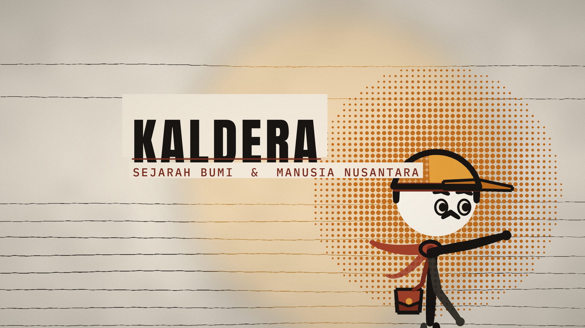

# KALDERA — Sejarah Bumi & Manusia Nusantara

Kanal animasi-dokumenter berbahasa Indonesia yang membedah peristiwa besar dalam
sejarah Bumi dari kacamata Nusantara.

**Bab 1 — Letusan Toba 74.000 Tahun Lalu: Apakah Kita Hampir Punah?**



---

## Apa isi repositori ini

| Jalur | Isi |
|---|---|
| `docs/00-analisis.md` | riset niche, pesaing, strategi judul & retensi |
| `docs/01-brand.md` | nama kanal, deskripsi, identitas visual, karakter |
| `docs/02-referensi-stickman.md` | riset kanal stickman YouTube + keputusan desain KAL |
| `docs/03-script.md` | naskah lengkap (VO per bab) |
| `docs/04-youtube.md` | judul, deskripsi, hashtag, tag, setelan unggah |
| `docs/06-sumber.md` | daftar sumber ilmiah |
| `engine/` | mesin gambar: palet, tekstur tinta/kertas, rig stickman |
| `tools/` | pembangun brand, komposisi gambar, audio, mixer, renderer, thumbnail |
| `art/raw/` | 10 plate hasil generate (tanpa figur manusia) |
| `art/final/` | 10 plate + KAL, siap 1080p |
| `brand/` | avatar, banner, lockup, font |
| `audio/` | narasi, musik, SFX, mix final |
| `video/` | hasil render |
| `social/` | thumbnail 1280×720 |

## Prinsip

- **Tidak ada manusia di dalam ilustrasi.** Semua figur adalah KAL, stickman
  yang digambar oleh rig sendiri (`engine/stickman.py`), sehingga identik di
  setiap frame dan setiap episode.
- **Semua aset orisinal.** Gambar dibuat khusus, musik & SFX disintesis dari
  nol, narasi ditulis untuk kanal ini.
- **Gaya cetak, bukan gaya render.** Palet 5 warna, garis tinta, tekstur kertas
  — supaya tidak terlihat seperti konten AI generik.

## Membangun ulang

```bash
python3 -m venv env --system-site-packages
env/bin/pip install pillow numpy scipy imageio-ffmpeg

env/bin/python tools/build_brand.py      # avatar, banner, lockup
env/bin/python tools/compose_art.py      # plate + KAL -> art/final
env/bin/python tools/audio.py all        # musik & sfx sintetis
env/bin/python tools/make_thumbs.py      # 3 varian thumbnail
env/bin/python tools/render_video.py --plan
env/bin/python tools/render_video.py --render
env/bin/python tools/mix.py              # audio/final_mix.wav
env/bin/python tools/render_video.py --mux
```

Butuh `ffmpeg` (otomatis lewat `imageio-ffmpeg`), RAM ±3 GB, 2 core.


---

## Build (satu perintah)

```bash
bash tools/build_all.sh     # plan -> mix -> srt -> render -> mux
```

| Tahap | Skrip | Keluaran |
|---|---|---|
| 1 | `tools/render_video.py --plan` | `scripts/timeline.json` |
| 2 | `tools/mix.py` | `audio/final_mix.wav` (-16 LUFS / -1.5 dBTP) |
| 3 | `tools/make_srt.py` | `social/KALDERA_Bab1_ID.srt` |
| 4 | `tools/render_video.py --render` | `video/_video.mp4` (1080p24, CRF 20) |
| 5 | `tools/render_video.py --mux` | `video/KALDERA_Bab1_Toba_1080p.mp4` |

Aset statis: `tools/compose_art.py` (plate + KAL -> `art/final/`),
`tools/audio.py all` (4 musik + 12 SFX), `tools/make_thumbs.py` (3 thumbnail).

Timeline dibangun **dari durasi narasi** (`audio/vo/vo10_*.mp3`), jadi setiap
perubahan teks otomatis menggeser shot, musik, SFX, dan subtitle.
